<p align="center">
  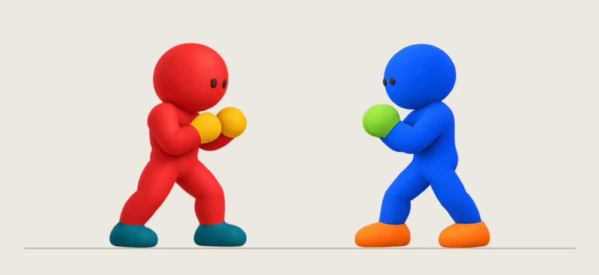
</p>

<h1 align="center">Spritesheet Expert</h1>

<p align="center"><strong>Generated art in. Game-ready sprites out.</strong></p>

<p align="center">
  <a href="https://gvastethecreator.github.io/spritesheet-expert-skill/">Live demo</a> ·
  <a href="#quick-start">Quick start</a> ·
  <a href="#lanes">Lanes</a> ·
  <a href="#healthy-sheets">Healthy sheets</a> ·
  <a href="v2/spritesheet-expert/SKILL.md">Skill</a>
</p>

An agent skill with one Python CLI. The image model draws the sheet; `sprite.py`
plans the prompt and layout guide, cuts out and registers every frame, packs the
atlas, writes a review page, and names every frame that needs a redraw.

- Works with any image model. The agent calls the provider; the CLI never does and holds no keys.
- Style follows the request. The demos use a soft vinyl-toy look; nothing forces it.
- Every source is stored with its SHA-256, so a changed file fails the build.

## Quick start

```bash
git clone https://github.com/gvastethecreator/spritesheet-expert-skill
cd spritesheet-expert-skill/v2/spritesheet-expert
pip install pillow numpy scipy

python sprite.py plan --out runs/hero --subject "a vinyl-toy fighter" \
  --anchor hero.png --view "side view, facing right" \
  --state idle:4 --state punch:6:attack:12
# generate prompts/<state>.txt with the anchor and guides/<state>.png attached, then:
python sprite.py build runs/hero --source idle=idle.png --source punch=punch.png --provider "my model"
python sprite.py check runs/hero --strict
```

Open `runs/hero/review.html` to play, step, onion-skin and read every check.

## Workflow

| Command | What it does |
| --- | --- |
| `plan` | Writes `run.json`, a prompt and a layout guide per state or set (pose mannequins for animation) |
| *(your agent)* | Generates the sheet with the anchor and guide attached |
| `build` | Cutout, frames on one baseline and one size, atlas, previews, `review.html` |
| `repair` | A kit per bad frame: its nearest healthy neighbors, the pose guide and a prompt |
| `check` | Source hashes, outputs and every open check; `--strict` exits 1 while anything is open |

Draw the whole sheet first, then redraw only what broke. Frames drawn together
share light, color and scale; a lone redraw is scaled back to its row on build.

## Lanes

### Animation

Walk, run, idle, attack, jump, hurt, cast and VFX rows. A pose mannequin per cell
sets each pose and the ground line. Build puts every frame on one baseline at one
body size, times frames by phase (anticipation and impact hold longer), and checks
scale, color, motion and the loop.

| Generated sheet | Built rows |
| --- | --- |
| 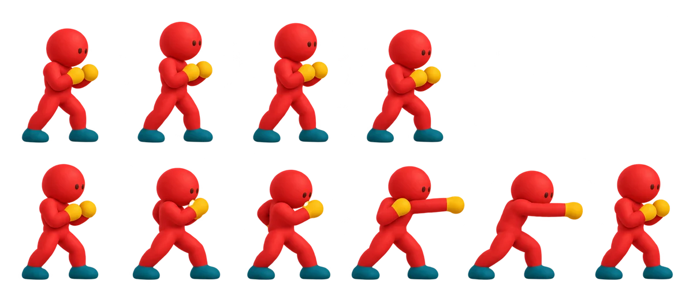 | 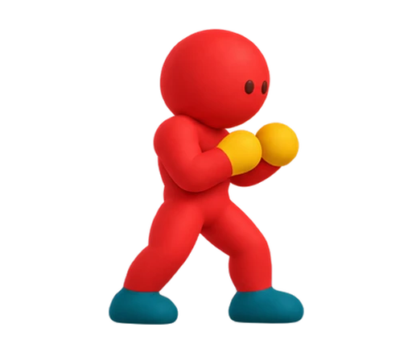 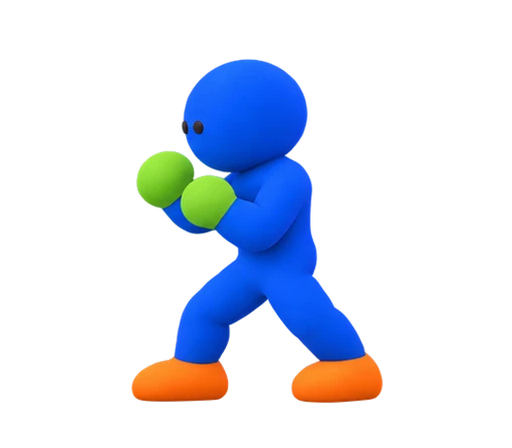 |

Recipe: [recipes/animation.md](v2/spritesheet-expert/recipes/animation.md)

### Slots

Named cells without time: a character's poses and gestures, icons, UI states and
stretchable panels. `--set NAME[:FIT]=a,b,c` picks how each set is placed.

| Fit | For | Placement |
| --- | --- | --- |
| `ground` | Poses and gestures | One scale, feet on the baseline |
| `center` | UI states | One size, centered |
| `fill` | Icons and items | Each fills its cell |
| `nine` | Panels | Centered, plus nine-slice margins in `atlas.json` |

<p>
  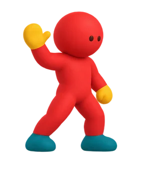
  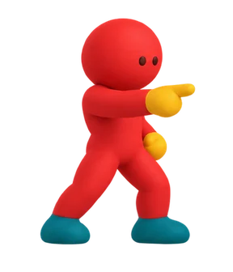
  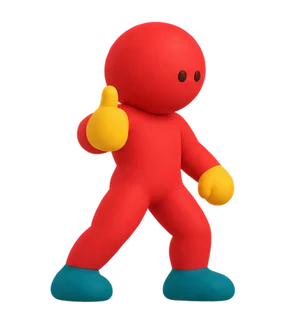
  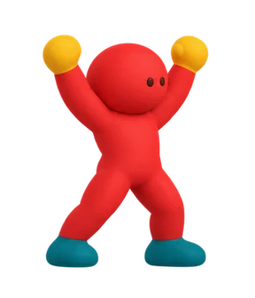
  
  
  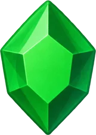
  
</p>

Recipe: [recipes/slots.md](v2/spritesheet-expert/recipes/slots.md)

### Atlas

Loose items with no grid. Build finds each item by its shape, keeps detached parts
with their owner (a bottle and its cap), drops specks, names items in reading order
and packs them tightly at one shared scale. If two items touch, the `items` check
fails instead of guessing.

| Generated: loose items | Built: separated and packed |
| --- | --- |
| 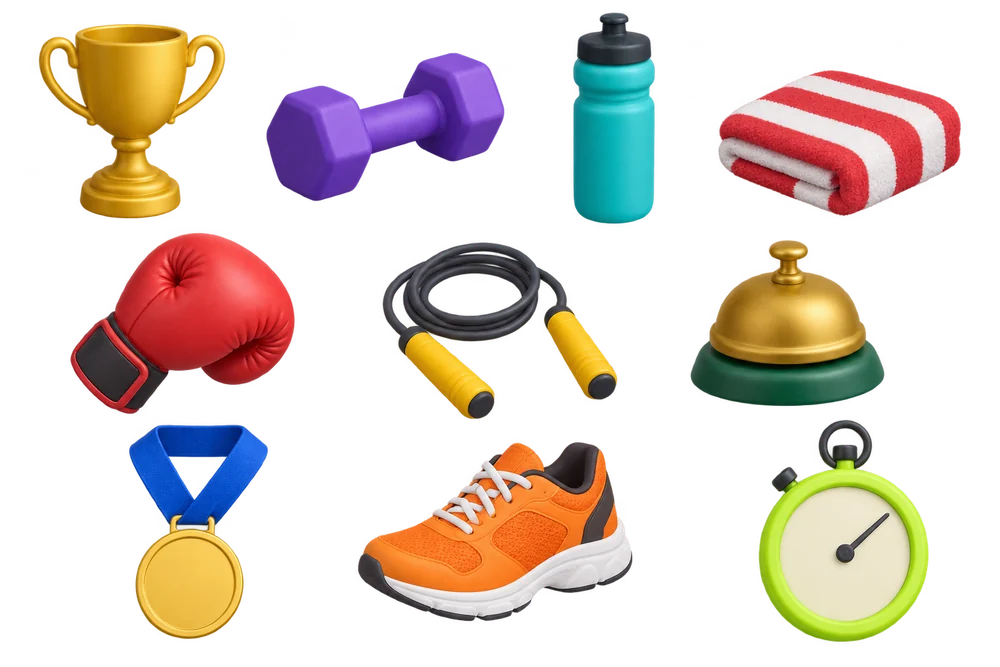 | 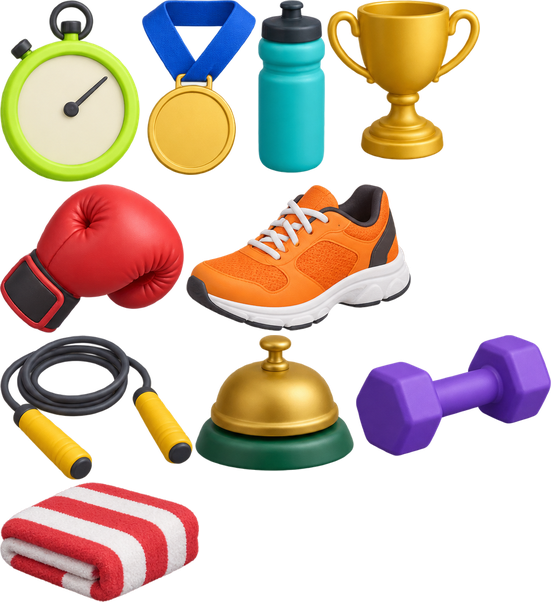 |

Recipe: [recipes/atlas.md](v2/spritesheet-expert/recipes/atlas.md)

## Healthy sheets

Checks name the frames to redraw: missing frames, size jumps, light shifts,
cut-off poses, matte halos, and states that drift apart in color. In this demo,
four faults were injected into a real generated sheet; the repairs are real
generations from `repair` kits.

| Before repair | After repair |
| --- | --- |
| 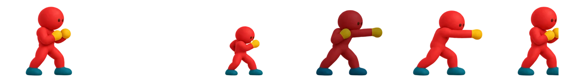 | 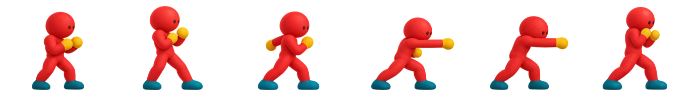 |
| 1 fail, 4 warnings | all checks pass |

```bash
python sprite.py repair runs/hero --state punch --frame 2 --frame 3
# generate each kit's in-between, then:
python sprite.py build runs/hero --patch punch:2=f2.png --patch punch:3=f3.png
```

## Outputs

| File | What it is |
| --- | --- |
| `atlas.png`, `atlas.json` | Cells or packed items, pivot, frame durations or slot names, nine-slice margins |
| `frames/<state>/NN.png` | Each runtime frame or item |
| `previews/<state>.webp` | Animated preview with alpha |
| `review.html` | Self-contained review page: play, step, onion skin, backgrounds, checks, source |
| `run.json` | Plan, sources with hashes, build report and checks |

## Requirements and status

- Python 3.11+, Pillow, numpy, scipy. Optional `rembg[cpu]` for BiRefNet cutouts on busy backgrounds.
- Lanes ready: animation, slots, atlas. Tiles and backgrounds come next; until then the v1 pack under [SKILLS/](SKILLS/) covers them.
- Demo art was generated with Cozy Studio; everything after generation is `sprite.py`.

MIT license.
