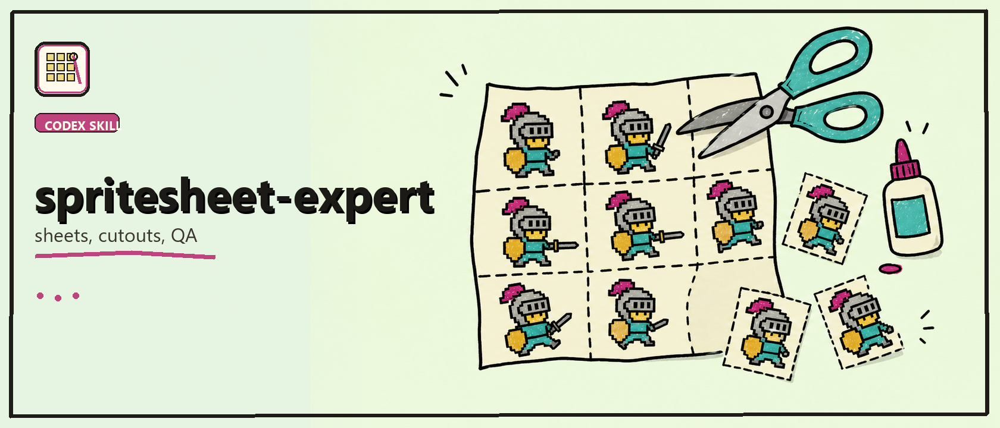

<p align="center">
  
</p>

<h1 align="center">Spritesheet Expert</h1>

<p align="center"><strong>Generated art in. Checked game assets out.</strong></p>

<p align="center">
  <a href="https://gvastethecreator.github.io/spritesheet-expert-skill/">Project site</a> ·
  <a href="#install">Install</a> ·
  <a href="#skills">Skills</a> ·
  <a href="#use">Use</a> ·
  <a href="#rules">Rules</a> ·
  <a href="SKILLS/README.md">Skill catalog</a>
</p>

Six agent skills for 2D game art. An image model draws the art. The skills cut
it out, register frames, pack atlases, validate each delivery, record where every
source came from, and write proof images and review pages for you to inspect.
They never paint replacement art.

## Install

Each folder under [`SKILLS/`](SKILLS/) is a complete skill and runs on its own.
Copy the ones you need into your agent's skills folder:

```bash
git clone https://github.com/gvastethecreator/spritesheet-expert-skill
cp -r spritesheet-expert-skill/SKILLS/spritesheet-expert <your-agent-skills-folder>/
```

Or use the skills.sh CLI:

```bash
npx skills add gvastethecreator/spritesheet-expert-skill
```

The skills need Python 3.11 or newer. Each one ships pinned requirements:

```bash
# spritesheet-expert
python -m pip install -r spritesheet-expert/scripts/requirements-core.txt
python spritesheet-expert/scripts/check_python_env.py   # prints what is missing

# every other skill
python -m pip install -r <skill>/requirements-runtime.txt
```

Optional capabilities have their own requirements in `spritesheet-expert`:
[video frame intake](SKILLS/spritesheet-expert/scripts/requirements-video.txt),
[rembg/BiRefNet cutouts](SKILLS/spritesheet-expert/scripts/requirements-background.txt),
and a [locked local model runtime](SKILLS/spritesheet-expert/model-runtime/README.md)
for Lucida and BEN2. None of them are needed for the deterministic commands.

New art comes from the image tool your agent already has. Imagegen is the
default; Grok Imagine is used only when you select it, and a paid run starts
with a dry run. No skill holds provider keys.

## Skills

| Skill | Use it for |
| --- | --- |
| [`spritesheet-expert`](SKILLS/spritesheet-expert/SKILL.md) | Item atlases, exact grids, animation rows, video frames, tilesets, textures |
| [`build-static-game-assets`](SKILLS/build-static-game-assets/SKILL.md) | Props, pickups, decals, item icons |
| [`build-game-backgrounds`](SKILLS/build-game-backgrounds/SKILL.md) | Layered, scrolling and parallax backgrounds |
| [`build-game-ui-kits`](SKILLS/build-game-ui-kits/SKILL.md) | UI controls, states, densities, nine-slice assets |
| [`compose-asset-mockups`](SKILLS/compose-asset-mockups/SKILL.md) | Store art, review boards and gameplay mockups from validated assets |
| [`produce-2d-assets`](SKILLS/produce-2d-assets/SKILL.md) | One delivery that spans two or more of the families above |

Use the narrowest skill that owns the asset. `produce-2d-assets` bundles the
five family workflows, so it works without the other skills installed.

## Use

Your agent reads the skill's `SKILL.md` and runs these commands. Paths are
relative to the installed skill folder.

### Sprites, atlases and tiles

`spritesheet-expert` picks one lane from the source and the result you ask for:

| Lane | For | Final gate |
| --- | --- | --- |
| `static-items` | Irregular items on one sheet | `validate_item_delivery.py` |
| `true-grid` | Exact slots or a non-animated variant set | `validate_run.py --stage pre-package` |
| `animation` | Animation rows or selected video frames | `validate_run.py --stage pre-package` |
| `tileset` | Adjacent tiles and repeat textures | `validate_run.py --stage pre-package` |

```bash
# loose items -> separated items, a packed atlas and a review playground
python scripts/run_item_atlas_workflow.py items.png --output-dir runs/items --models none

# show the lane and final gate a run resolves to; drop --describe to run the gate
python scripts/check_workflow.py --run-dir runs/items --describe
```

An item run writes `alpha/atlas.png`, `alpha/manifest.json`, one PNG per item and
`qa/item-playground/index.html`, where you filter items, approve or reject them,
and export a review file for `apply_item_review.py`. Row, animation and tileset
runs are prepared with `preset_to_request.py` and `prepare_sprite_run.py`. Each
finished run also gets a review page at `qa/preview-workbench/index.html`.

`scripts/serve_item_studio.py` opens Studio, a local browser workspace for item
runs.

### Static assets, backgrounds and UI kits

Write the pack file against the skill's schema, then validate it:

```bash
python scripts/validate_static_pack.py --pack <root>/static-pack.json --root <root>
python scripts/validate_background_pack.py --pack <root>/background-pack.json --root <root>
python scripts/validate_ui_kit.py --kit <root>/ui-kit.json --root <root>
```

| Skill | Writes |
| --- | --- |
| `build-static-game-assets` | `qa/static-pack-report.json`, a contact sheet on checker, black, gray and white |
| `build-game-backgrounds` | `qa/background-pack-report.json`, a layer composite, a horizontal scroll GIF |
| `build-game-ui-kits` | `qa/ui-kit-report.json`, a state board, a nine-slice stretch board |

### Mockups and multi-family packs

```bash
# seal a presentation contract and copy its pinned inputs
python scripts/prepare_presentation.py --presentation <root>/presentation.json --root <root>

# validate one delivery and every leaf report it pins
python scripts/validate_asset_pack.py --pack <root>/asset-pack.json --pack-root <root>
```

Every mockup carries a truth label: `concept`, `reconstructed` or
`runtime-captured`. `validate_asset_pack.py` exits `0` on pass, `1` on a contract
failure, `2` while a dependency is still blocked and `3` on an operational failure.

## Rules

- **Models draw, code processes.** Scripts prepare, extract, register, cut out,
  compose, preview and validate. They never create replacement production art.
- **Native alpha first.** Isolated sprites, props and UI keep valid provider
  transparency. A gray, black or white matte is the fallback; new sources never
  use green, blue, cyan or magenta chroma.
- **Every source has a record.** Each source declares its provider or import
  provenance and SHA-256 hash.
- **Fixtures are not art.** A fixture can pass validation, but it never counts as
  representative production media.
- **Proof matches the asset.** Animation needs playback, contact and onion-skin
  views; backgrounds a composite and a scroll sample; UI state and stretch
  boards; static art a contact sheet on several backgrounds.
- **A passing validator is not engine-tested.** Check the real engine loader
  before you call an asset engine-ready.

## Development

Requirements: Node.js 24, pnpm 11.21, Python 3.11 or newer.

```bash
pnpm install --frozen-lockfile
pnpm run setup:test   # install the pinned Python test environment
pnpm run validate     # skill pack, bundles, evals, motion templates, theme, Studio
pnpm test             # pytest suite
pnpm run smoke        # deterministic pipeline smoke test on fixtures
pnpm run check        # full gate: doctor, validate, test, smoke
```

After you change a family skill, run `pnpm run sync:bundles` to refresh the copy
inside `produce-2d-assets`. See [CONTRIBUTING.md](CONTRIBUTING.md) and the
[changelog](docs/CHANGELOG.md).

## Support

You can [sponsor maintenance](https://github.com/sponsors/gvastethecreator) or
[support it on Ko-fi](https://ko-fi.com/gvaste). Report bugs in
[GitHub Issues](https://github.com/gvastethecreator/spritesheet-expert-skill/issues).

## License

MIT. `spritesheet-expert` also ships the Apache-2.0 license and notice files for
sprite-gen ([LICENSE.sprite-gen](SKILLS/spritesheet-expert/LICENSE.sprite-gen),
[NOTICE.sprite-gen](SKILLS/spritesheet-expert/NOTICE.sprite-gen)).
