<p align="center">
  <picture>
    <source media="(prefers-color-scheme: dark)" srcset="https://shieldcn.dev/header/document.svg?title=Spritesheet+Expert&subtitle=Generated+art+in.+Game-ready+sprites+out.&logo=grid3x3&theme=blue&align=center&mode=dark" />
    
  </picture>
</p>

<p align="center">
  <a href="https://github.com/gvastethecreator/spritesheet-expert-skill/actions/workflows/ci.yml"></a>
  <a href="https://gvastethecreator.github.io/spritesheet-expert-skill/"></a>
  <a href="https://www.python.org/"></a>
  <a href="LICENSE"></a>
</p>

<p align="center">
  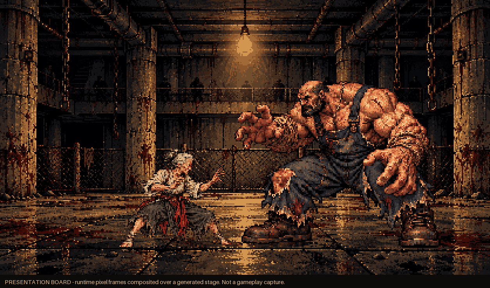
</p>

Agent skills that turn generated 2D game art into **game-ready, verified assets**: exact pixels, registered frames, packed atlases, runtime manifests, and a pass/fail receipt for every file.

An image model draws. These skills do everything after that.

[Live workbench](https://gvastethecreator.github.io/spritesheet-expert-skill/) · [Install](#install) · [Lanes](#lanes) · [Review tools](#review-tools) · [Skills](./SKILLS/README.md)

## Why

Image models paint convincing sprites, but not usable ones. The grid is irregular, the alpha is soft, each frame has its own scale, and nothing proves the result is the same character. This pack fixes that with deterministic tools and explicit gates, and it never paints replacement art.

| Provider output | After the pipeline |
| --- | --- |
| 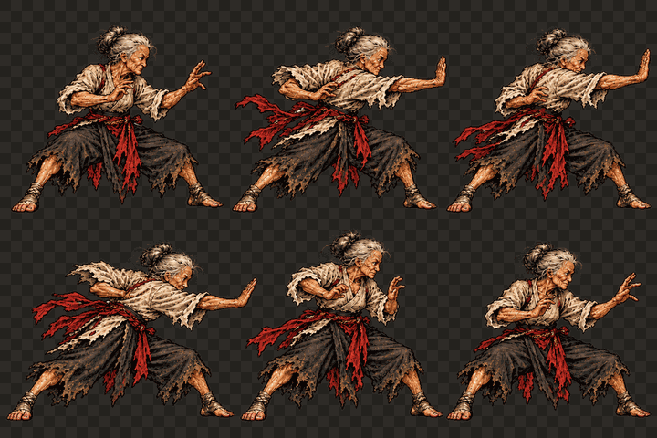 | 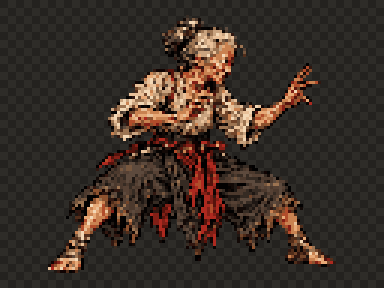 |
| Pixel-looking art on an irregular grid, soft alpha | Exact grid, 24-color palette, hard alpha, one baseline |

## Lanes

Every example below is real output from three demo worlds: a **sci-fi** maintenance drone, a **fighting game** inspired by grotesque martial-arts manga, and a **dungeon** run as a bureaucracy. The art was generated with Cozy Studio, then processed by the scripts in this repo.

### Animation grid → runtime row

A compact grid drifts less than a long strip. Frames are segmented, registered to one baseline at one scale, and checked against a motion contract.

| Sci-fi walk · pixel | Sci-fi walk · HD | Dungeon idle · HD |
| --- | --- | --- |
| 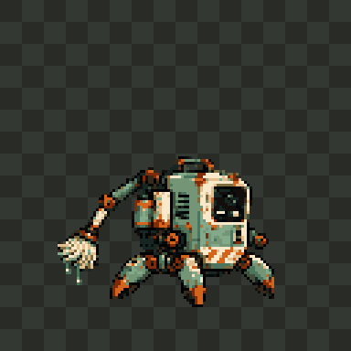 | 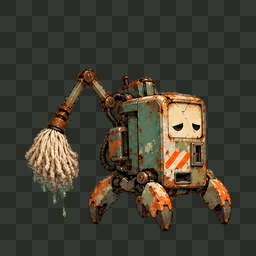 | 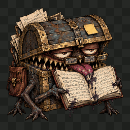 |

Gates: provenance, frame alignment, identity, locomotion or idle contract, motion variation, runtime playback, `validate_run`.

```powershell
python SKILLS/spritesheet-expert/scripts/extract_sprite_row_frames.py --run-dir run --background-removal alpha --alpha-mode hard
python SKILLS/spritesheet-expert/scripts/compose_sprite_atlas.py --run-dir run
python SKILLS/spritesheet-expert/scripts/validate_run.py --run-dir run --stage post-extract
```

### Loose items → packed atlas

Items anywhere on a transparent sheet. Each one keeps its exact pixels, owns its pixels exclusively, and gets its own atlas rect.

| Provider sheet | Packed atlas |
| --- | --- |
| 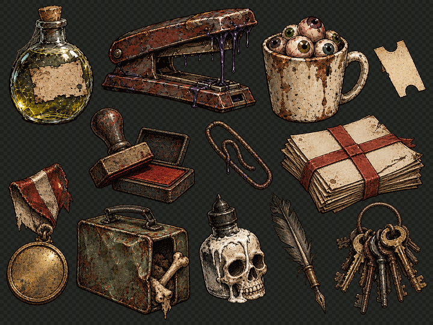 | 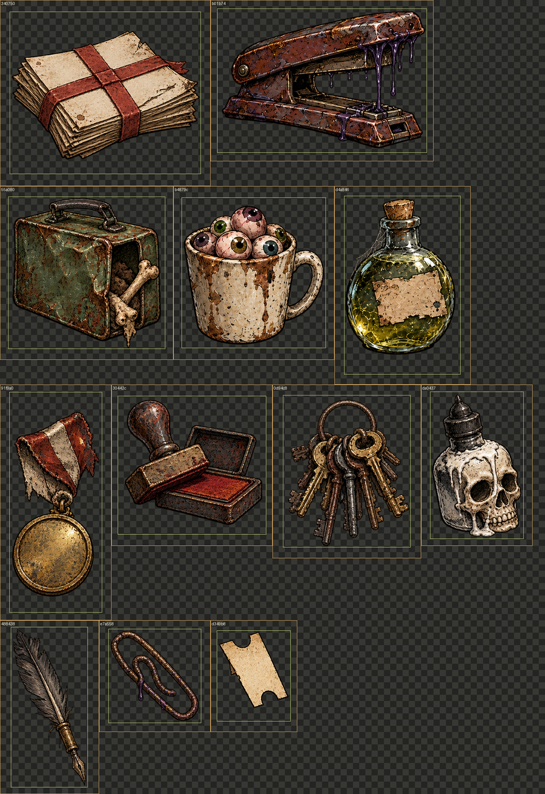 |

```powershell
python SKILLS/spritesheet-expert/scripts/run_item_atlas_workflow.py loot.png --output-dir run
```

### VFX and pose sets

| Hit spark · build-up, peak, decay | Intern · four facings |
| --- | --- |
| 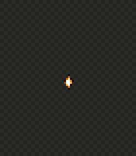 | 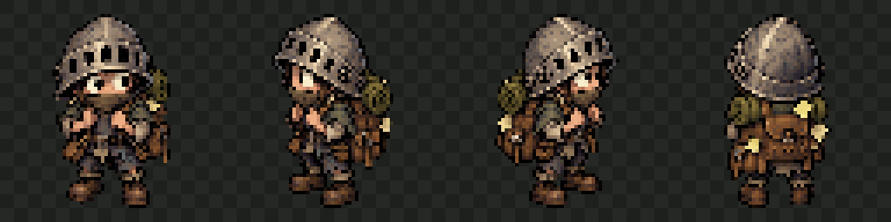 |

### Backgrounds, UI kits, tiles

| Parallax pack (`build-game-backgrounds`) | UI kit (`build-game-ui-kits`) |
| --- | --- |
| 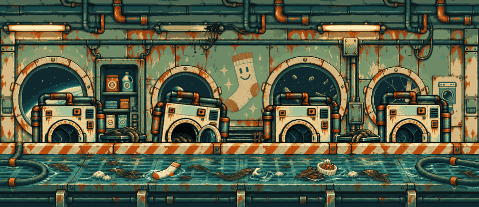 | 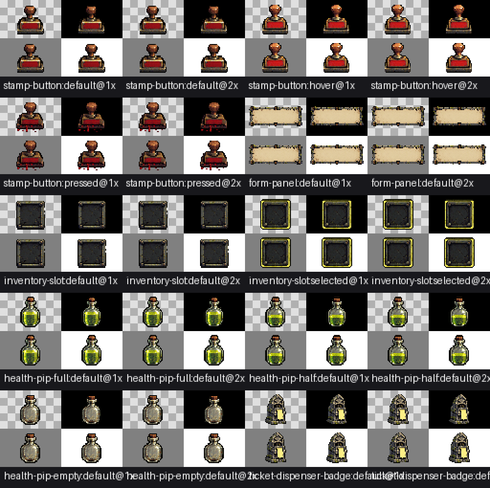 |
| Layers checked for horizontal repeat, then shown as a composite and a scroll proof | Every state and density on checker, black, gray, and white, plus a nine-slice stretch proof |

Tiles get a numeric edge check and a 3×3 repeat proof before they reach a map.

## Review tools

Every run builds its own single-file review tools: no server, no network. They share one visual system, so a workbench, a playground, and Studio all read the same way.

| Preview workbench | Item playground |
| --- | --- |
| 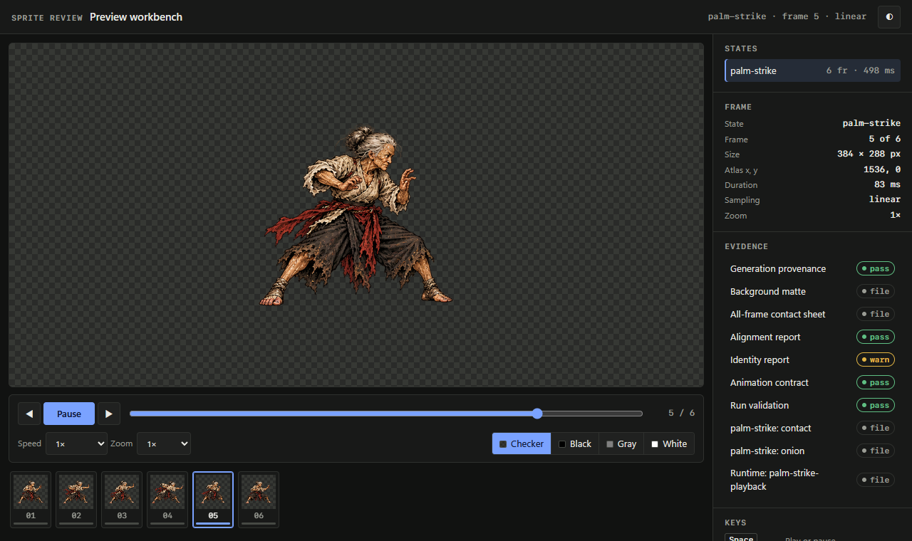 | 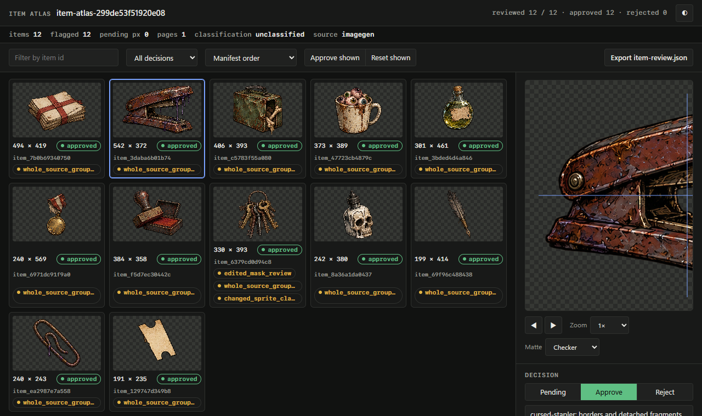 |
| **Studio** | **Motion workbench** |
| 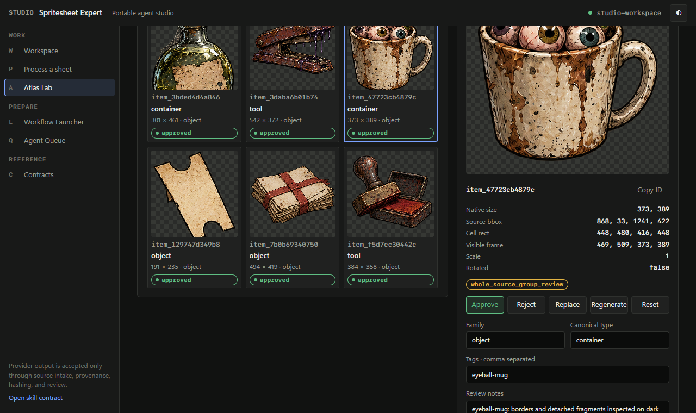 | 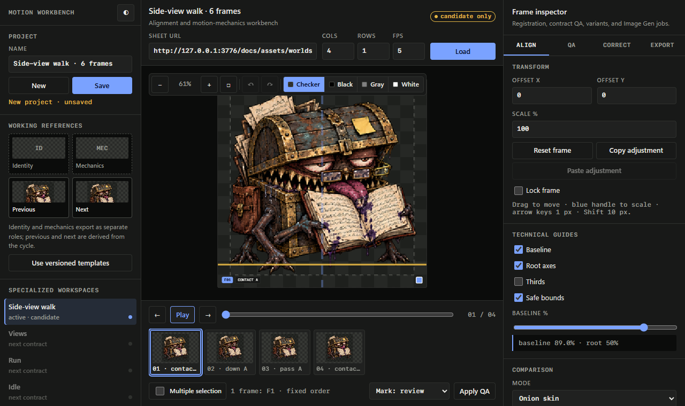 |

The system lives in [`spritecore/tool_theme.py`](./SKILLS/spritesheet-expert/scripts/spritecore/tool_theme.py). See [docs/architecture/tool-ui-system.md](./docs/architecture/tool-ui-system.md).

## Install

```powershell
npx skills add gvastethecreator/spritesheet-expert-skill
```

| Skill | Use it for |
| --- | --- |
| [`spritesheet-expert`](./SKILLS/spritesheet-expert/SKILL.md) | Item atlases, animation rows, pose sets, VFX, tilesets, video frames |
| [`build-static-game-assets`](./SKILLS/build-static-game-assets/SKILL.md) | Props, pickups, decals, item packs |
| [`build-game-backgrounds`](./SKILLS/build-game-backgrounds/SKILL.md) | Layered, scrolling, parallax backgrounds |
| [`build-game-ui-kits`](./SKILLS/build-game-ui-kits/SKILL.md) | UI states, densities, nine-slice assets |
| [`compose-asset-mockups`](./SKILLS/compose-asset-mockups/SKILL.md) | Labeled presentation boards from validated assets |
| [`produce-2d-assets`](./SKILLS/produce-2d-assets/SKILL.md) | Deliveries that span several families |

Use the narrowest skill that owns the asset. Image generation uses `$imagegen` by default; `$grok-imagine` is an optional route that starts with a dry run.

## Rules the pipeline keeps

- **Models draw, code processes.** Scripts cut, register, pack, and check. They never paint replacement art.
- **Native alpha first.** Isolated sprites, props, and UI ask the provider for transparency. Flat gray, black, or white is the fallback.
- **Pixel art stays pixel art.** Exact grid, nearest-neighbour scaling, hard alpha, fixed palette.
- **Every source has a receipt.** Provider, job id, hashes, and license go into `source-provenance.json`.
- **Fixtures never count as art.** Smoke tests can pass on fixtures, but only real sources count as representative media.

## Commands

```powershell
pnpm run setup:test      # install the pinned Python environment
pnpm run doctor:test     # check it
pnpm run smoke           # deterministic smoke test on fixtures
pnpm run studio          # open Studio on a local workspace
pnpm run validate        # validate the skill pack, evals, Studio, and theme sync
pnpm test                # contract and integration suite
pnpm run check           # full release gate
```

Optional cutout models are isolated by capability: the [locked model runtime](./SKILLS/spritesheet-expert/model-runtime/README.md) covers Lucida and BEN2, the [background requirements](./SKILLS/spritesheet-expert/scripts/requirements-background.txt) cover rembg/BiRefNet, and the [video requirements](./SKILLS/spritesheet-expert/scripts/requirements-video.txt) cover video-frame ingestion. None are bundled.

## Support

If this toolkit helps your pipeline, you can [sponsor its maintenance](https://github.com/sponsors/gvastethecreator) or [support it on Ko-fi](https://ko-fi.com/gvaste). Bug reports and focused improvements are welcome through [GitHub Issues](https://github.com/gvastethecreator/spritesheet-expert-skill/issues) and [CONTRIBUTING.md](CONTRIBUTING.md).

## License

MIT. Some bundled sprite pipeline files keep their original Apache-2.0 notice files inside the skill package. The demo art in `docs/assets/worlds/` was generated for this project and ships under the same license.
